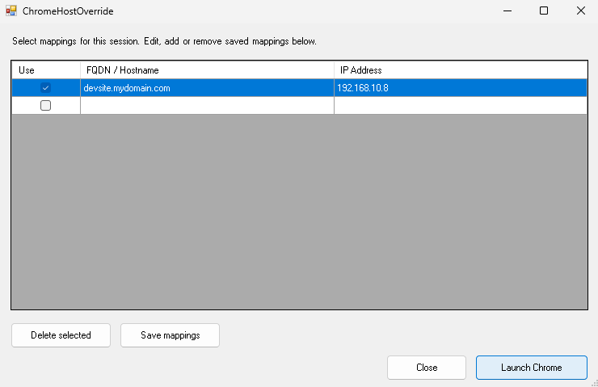
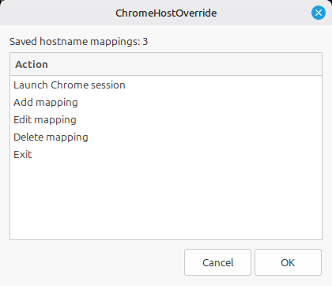
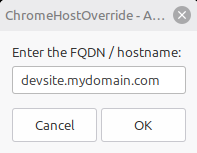
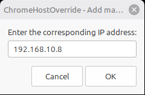
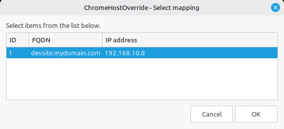
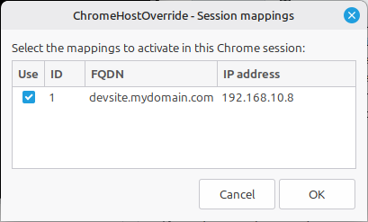

# ChromeHostOverride

A simple wrapper for isolated Chrome sessions with custom host overrides.

## Features

- Launches Google Chrome or Chromium with custom hostname-to-IP mappings.
- Supports multiple FQDN/IP pairs, including IPv4 and IPv6.
- Uses Chrome's `--host-resolver-rules` command-line option to override hostname resolution.
- Persists mappings in a JSON database so they can be reused across sessions.
- Add, edit, and delete saved mappings from the GUI.
- Enable or disable individual mappings per session (per-row `Use` checkbox on Windows; checklist on Linux).
- Validates hostnames against RFC 1035 / RFC 1123 and IP addresses before saving.
- Detects duplicates (case-insensitive, trailing-dot-insensitive).
- Creates a separate, timestamped browser profile for every session.
- Optionally detects and removes previous isolated profiles.
- Provides a graphical interface on both Linux and Windows.


## Screenshots

| Windows | Linux |
| :---: | :---: |
|  |  |
||  |
||  |
||  |
||  |


## Requirements

### Linux

- Bash 4.3 or later
- Google Chrome or Chromium (supporting `--host-resolver-rules`)
- Python 3
- [Zenity](https://help.gnome.org/users/zenity/stable/) (graphical dialogs)

On Debian/Ubuntu:

```bash
sudo apt install zenity python3
```

### Windows

- Windows 10 or later
- Windows PowerShell 5.1 or PowerShell 7
- Google Chrome or Chromium (supporting `--host-resolver-rules`)

The Windows implementation uses Windows Forms for its graphical interface. No additional GUI dependencies are required.

## Installation

Clone the repository:

```bash
git clone https://github.com/hmmmonteiro/ChromeHostOverride.git
cd ChromeHostOverride
```

### Linux

Make the script executable:

```bash
chmod +x Linux/ChromeHostOverride.sh
```

### Windows

No installation is required. The PowerShell script can be executed directly.

## Usage

### Linux

Run:

```bash
./Linux/ChromeHostOverride.sh
```

### Windows

Run from PowerShell:

```powershell
powershell.exe -NoProfile -STA -ExecutionPolicy Bypass -File ".\Windows\ChromeHostOverride.ps1"
```

Or

Double-click:

`Windows/ChromeHostOverride.bat`

Alternatively, run it from Command Prompt:

```batch
ChromeHostOverride.bat
```

The graphical interface will guide you through the workflow.

### Managing saved mappings

Mappings are stored persistently and reused across sessions.

**Windows**

- The main window shows an editable table with columns **Use**, **FQDN / Hostname**, and **IP Address**.
- The **Use** checkbox controls which mappings are included in the next Chrome session. Its state is saved and restored on the next start.
- **Save mappings** validates every row and writes the database to disk.
- **Delete selected** removes one or more selected rows.
- A new row can be added directly in the table (the last row is always an empty "new row" — leave both cells blank to ignore it).

**Linux**

- The main menu provides **Add mapping**, **Edit mapping**, and **Delete mapping** entries. Changes are written to disk immediately.
- When launching, a checklist dialog lets you select which saved mappings to activate for this session. The selection is remembered and pre-checked the next time the dialog opens.

### Launching a session

1. Add or edit hostname mappings as needed.
2. Tick (or pre-select) the mappings you want to activate for this launch.
3. Click **Launch Chrome** (Windows) or choose **Launch Chrome session** (Linux).
4. Review the confirmation dialog listing the active `MAP` rules.
5. Optionally, clear previous isolated profiles.
6. Chrome opens in a fresh, isolated profile with the resolver rules applied.

### Mapping storage

Saved mappings live in a JSON file per platform:

| Platform | Location |
| :--- | :--- |
| Linux | `${XDG_CONFIG_HOME:-$HOME/.config}/chromehostoverride/mappings.json` |
| Windows | `%APPDATA%\ChromeHostOverride\mappings.json` |

Example:

```json
{
  "mappings": [
    { "fqdn": "api.local",   "ip": "127.0.0.1", "use": true  },
    { "fqdn": "admin.local", "ip": "10.0.0.42", "use": false },
    { "fqdn": "app.example", "ip": "::1",       "use": true  }
  ]
}
```

The `use` field determines whether the mapping is pre-selected in the next launch dialog. Older files without `use` are read as `use: false`.

### Hostname validation

Hostnames are validated against **RFC 1035** and **RFC 1123**:

- Total length 1–253 characters.
- Labels 1–63 characters, separated by dots.
- Each label starts and ends with a letter or digit.
- Allowed label characters: `A–Z`, `a–z`, `0–9`, hyphen (`-`).
- Underscores are rejected (not valid in hostnames).
- A single trailing dot is stripped (FQDN form).
- Single-label names such as `localhost` are allowed.

IP addresses must be valid IPv4 or IPv6. Duplicate hostnames are rejected (case-insensitive, trailing-dot-insensitive).

## How it works

ChromeHostOverride uses Chrome's built-in `--host-resolver-rules` command-line option to redirect specified hostnames to supplied IP addresses, without modifying the system's DNS configuration or hosts file.

Each launch receives its own timestamped user-data directory:

**Linux:**

```text
${XDG_CACHE_HOME:-$HOME/.cache}/IsolatedChrome_YYYYMMDD_HHMMSS_NNNNNNNNN/
```

**Windows:**

```text
%LOCALAPPDATA%\ChromeHostOverride\IsolatedChrome_YYYYMMDD_HHMMSS_NNN\
```

This provides separation of browser data, cookies and session state from your regular Chrome profile and other isolated sessions.

Previous profiles can optionally be removed when launching a new session.

## Security note

ChromeHostOverride provides browser-profile isolation, not an additional security sandbox.

It does not provide operating-system-level isolation of processes, filesystem access or network access. Chrome's own built-in security sandbox remains responsible for browser process isolation.

## License

This project is licensed under the **GNU General Public License v3.0 (GPL-3.0)**. See [LICENSE](LICENSE) for details.
